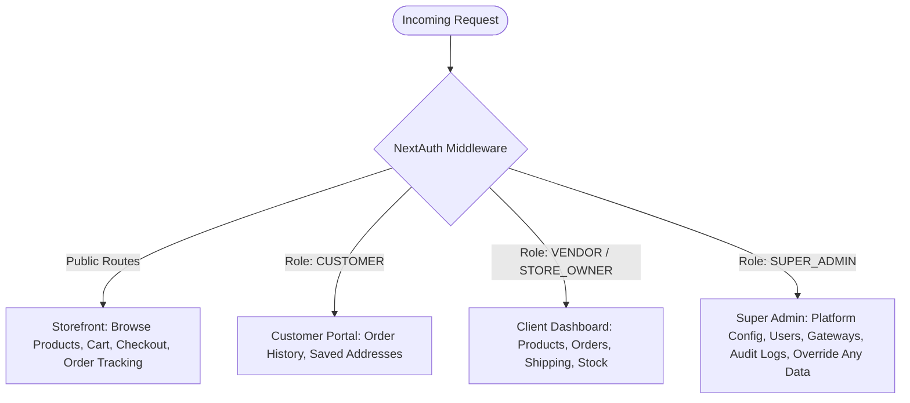

# The Bling Corner - E-Commerce Platform: Master Architecture & Blueprint

> **Role Perspective**: Senior Engineering Team (Architect, UI/UX Designer, Frontend, Backend, Database Specialist, Security Engineer, QA/Test Lead, DevOps, Code Reviewer).  
> **Target Brand**: The Bling Corner (`theblingcorner_`)  
> **Cost Constraint**: **100% Free Tier Hosting & Infrastructure ($0/month)**  
> **Core Stack**: Next.js (App Router, TypeScript), Tailwind CSS, PostgreSQL + Prisma ORM, NextAuth.js (v5 / Auth.js), Razorpay (India UPI/Cards) + Stripe (International), Supabase / Neon, Vercel.

---

## 1. Requirements & System Overview

### 1.1 Business Model & Traffic Profile
- **Primary Acquisition Funnel**: Instagram bio link, stories, reels, WhatsApp broadcasts.
- **Traffic Nature**: 85–92% mobile users entering through in-app browsers (Instagram, Facebook, WhatsApp).
- **Payment Model**: **100% Prepaid Only** (No Cash-on-Delivery). Orders are only created/fulfilled after verified payment receipt.
- **Shipping Model**: Custom tier-based courier shipping rate card derived from physical client rates (`chart.jpeg`).

### 1.2 "Best-of-Breed" 100% Free Hybrid Architecture ($0 Total Cost)

Instead of locking into just one provider, we take the **absolute best free service** from each platform:

| Layer | Selected Service | Why It Is The Winner | Free Tier Quota | Monthly Cost |
| :--- | :--- | :--- | :--- | :--- |
| **Relational Database** | **Supabase (PostgreSQL + Prisma)** | E-commerce needs strict tables (Orders, Items, Payments). Prevents inventory bugs, guarantees financial accuracy. | 500 MB (enough for 100,000+ orders) | **$0.00** |
| **Product Photos & Media** | **Google Firebase Storage** | **5x more free storage** than Supabase (5 GB vs 1 GB). Ideal for high-resolution jewelry and charm photos. | **5 GB free storage** (thousands of images) | **$0.00** |
| **Web Hosting & Domain** | **Google Firebase Hosting & Vercel** | Free official Google domain: **`https://theblingcorner.web.app`** with free SSL, global CDN, $0/month | 10 GB storage / 100 GB traffic | **$0.00** |
| **Authentication & Roles** | **NextAuth.js (Prisma Adapter)** | Master control for Super Admin, Client Vendor, and Customers with zero external user fees. | Unlimited users | **$0.00** |
| **Payments** | **Razorpay** | Direct Indian UPI (GPay, PhonePe, Paytm), Netbanking & Cards. | ₹0 setup fee, ₹0 monthly maintenance | **$0.00 fixed** |
| **Transactional Emails** | **Resend** | Order confirmation receipts to client & customer. | 3,000 emails/month (100/day) | **$0.00** |

---

## 2. Dynamic Shipping Rate Engine (From Client Chart)

Based on the client's official courier rate matrix (`chart.jpeg`, w.e.f. August 2026):

```
Weight (Grams) | Local (₹) | Within State (₹) | Zone / Metro (₹) | Other State (₹)
-------------- | --------- | ---------------- | ---------------- | ---------------
<= 500g        | 34        | 77               | 82               | 84
501g - 1000g   | 56        | 107              | 126              | 134
1001g - 1500g  | 70        | 139              | 168              | 201
1501g - 2000g  | 103       | 188              | 234              | 283
> 2000g        | + Pro-rata calculated per 500g slab
```

- Each product has an assigned package weight (in grams, default 150g for jewelry/charms).
- Cart calculates total combined weight.
- Customer enters delivery pincode.
- System automatically detects zone: `LOCAL`, `WITHIN_STATE`, `METRO`, or `OTHER_STATE`.
- Accurate shipping rate is computed server-side and added to order subtotal before creating payment order.

---

## 3. Product Catalog Structure (From Client Inventory)

Initial categories & sub-items based on client inventory sheet (`Screenshot 2026-11-07 204624.png`):

1. **Keychains**: Water (big, small), Starbucks, Scented, Cloud lamp (light), Keyboard, Partner's, Dice, Bear bell, Crochet, Astronaut, Basketball, Astronomy square, Panda, Shell, Green bell, Jackpot.
2. **Hair Clips**: Pearl, Min Min, Superior, Kuromi (Big & Small), Cloud, M&M, Bear.
3. **Stationery**: A5 Diary, Panda Pocket, Sticky Notes, Color Palette, Highlighter, Scissor, 3D Sticker (Blue, Pink), Washi Tapes, Diamond Painting, Pens (Matcha brown, Tea taste, pastel green, green), Erasable Gel Pen, Planet Space.
4. **Bracelets**: Glass Beads, Crystal Beads, Tulip, Star, Infinity, Crystal Bow, Pearl, Floral, Ocean Bold, Pearl Bow, Evil Eye, Pastel Crystal, Cherry Crystal, Cherry White, Customize Name, Dumble.
5. **Charms**:
   - Phone charms: Tulip, Pearl, Crystal Blue, Panda.
   - Bag charms: Cherry, Mini Leather, Heart.
   - Miniature charms: Coca Cola, Monster (white, pink, orange), Redbull, Cheesecake, Strawberry, Silver Heart, Headphone.
   - Crystal Bow.
6. **Wipes**: Mini, Can.

---

## 4. Multi-Role Permission & Security Matrix



- **Super Admin (You)**: Complete master access. Can create/modify store owner credentials, inspect all database tables, modify system settings, change payment keys, override any order or transaction, and view system error logs.
- **Vendor / Store Owner (Client)**: Add/edit products, upload images, update inventory counts, manage order statuses (`PROCESSING` → `PACKED` → `SHIPPED` + Courier Tracking Number → `DELIVERED`), print shipping invoices.
- **Customer**: Fast guest checkout or account login, order history, live parcel tracking, product reviews with photos.

---

## 5. Production Database Schema (`prisma/schema.prisma`)

```prisma
datasource db {
  provider = "postgresql"
  url      = env("DATABASE_URL")
  directUrl = env("DIRECT_URL")
}

generator client {
  provider = "prisma-client-js"
}

enum Role {
  CUSTOMER
  VENDOR
  SUPER_ADMIN
}

enum OrderStatus {
  PENDING_PAYMENT
  PAID
  PROCESSING
  PACKED
  SHIPPED
  DELIVERED
  CANCELLED
  REFUNDED
}

enum PaymentStatus {
  PENDING
  SUCCESS
  FAILED
  REFUNDED
}

enum ShippingZoneType {
  LOCAL
  WITHIN_STATE
  ZONE_METRO
  OTHER_STATE
}

model User {
  id            String    @id @default(cuid())
  name          String?
  email         String    @unique
  emailVerified DateTime?
  passwordHash  String?
  phone         String?
  role          Role      @default(CUSTOMER)
  image         String?
  createdAt     DateTime  @default(now())
  updatedAt     DateTime  @updatedAt

  addresses     Address[]
  orders        Order[]
  reviews       Review[]
  auditLogs     AuditLog[]
}

model Address {
  id           String   @id @default(cuid())
  userId       String?
  user         User?    @relation(fields: [userId], references: [id], onDelete: Cascade)
  fullName     String
  phone        String
  street       String
  landmark     String?
  city         String
  state        String
  pincode      String
  isDefault    Boolean  @default(false)
  createdAt    DateTime @default(now())
  updatedAt    DateTime @updatedAt
  
  orders       Order[]
}

model Category {
  id          String    @id @default(cuid())
  name        String    @unique
  slug        String    @unique
  description String?
  imageUrl    String?
  displayOrder Int      @default(0)
  createdAt   DateTime  @default(now())
  updatedAt   DateTime  @updatedAt

  products    Product[]
}

model Product {
  id            String    @id @default(cuid())
  title         String
  slug          String    @unique
  description   String    @db.Text
  price         Decimal   @db.Decimal(10, 2)
  comparePrice  Decimal?  @db.Decimal(10, 2)
  weightGrams   Int       @default(150)
  stockQuantity Int       @default(0)
  sku           String?   @unique
  isFeatured    Boolean   @default(false)
  isActive      Boolean   @default(true)
  categoryId    String
  category      Category  @relation(fields: [categoryId], references: [id])
  images        ProductImage[]
  variants      ProductVariant[]
  reviews       Review[]
  orderItems    OrderItem[]
  createdAt     DateTime  @default(now())
  updatedAt     DateTime  @updatedAt

  @@index([categoryId])
  @@index([slug])
}

model ProductImage {
  id        String   @id @default(cuid())
  productId String
  product   Product  @relation(fields: [productId], references: [id], onDelete: Cascade)
  url       String
  altText   String?
  isPrimary Boolean  @default(false)
  sortOrder Int      @default(0)
}

model ProductVariant {
  id          String   @id @default(cuid())
  productId   String
  product     Product  @relation(fields: [productId], references: [id], onDelete: Cascade)
  title       String   // e.g. "Color: Blue", "Size: Small"
  sku         String?  @unique
  price       Decimal? @db.Decimal(10, 2)
  stock       Int      @default(0)
  weightGrams Int?
}

model Order {
  id             String        @id @default(cuid())
  orderNumber    String        @unique // e.g. TBC-202611-1001
  userId         String?
  user           User?         @relation(fields: [userId], references: [id], onDelete: SetNull)
  guestEmail     String?
  guestPhone     String?
  addressId      String?
  address        Address?      @relation(fields: [addressId], references: [id])
  shippingAddress Json         // Snapshot of address at order time
  
  subtotal       Decimal       @db.Decimal(10, 2)
  shippingFee    Decimal       @db.Decimal(10, 2)
  totalWeightGrams Int         @default(0)
  discountAmount Decimal       @default(0) @db.Decimal(10, 2)
  totalAmount    Decimal       @db.Decimal(10, 2)
  
  status         OrderStatus   @default(PENDING_PAYMENT)
  paymentStatus  PaymentStatus @default(PENDING)
  trackingNumber String?
  courierPartner String?
  notes          String?       @db.Text
  
  items          OrderItem[]
  payment        Payment?
  createdAt      DateTime      @default(now())
  updatedAt      DateTime      @updatedAt

  @@index([orderNumber])
  @@index([userId])
}

model OrderItem {
  id         String   @id @default(cuid())
  orderId    String
  order      Order    @relation(fields: [orderId], references: [id], onDelete: Cascade)
  productId  String
  product    Product  @relation(fields: [productId], references: [id])
  title      String
  quantity   Int
  unitPrice  Decimal  @db.Decimal(10, 2)
  totalPrice Decimal  @db.Decimal(10, 2)
  imageUrl   String?
}

model Payment {
  id              String        @id @default(cuid())
  orderId         String        @unique
  order           Order         @relation(fields: [orderId], references: [id], onDelete: Cascade)
  gateway         String        @default("RAZORPAY") // RAZORPAY or STRIPE
  gatewayOrderId  String        @unique
  gatewayPaymentId String?      @unique
  gatewaySignature String?
  amount          Decimal       @db.Decimal(10, 2)
  currency        String        @default("INR")
  status          PaymentStatus @default(PENDING)
  payload         Json?
  createdAt       DateTime      @default(now())
  updatedAt       DateTime      @updatedAt
}

model ShippingRateRule {
  id          String           @id @default(cuid())
  maxWeight   Int              // in grams (500, 1000, 1500, 2000)
  zone        ShippingZoneType
  price       Decimal          @db.Decimal(10, 2)
  createdAt   DateTime         @default(now())
  updatedAt   DateTime         @updatedAt

  @@unique([maxWeight, zone])
}

model Review {
  id        String   @id @default(cuid())
  productId String
  product   Product  @relation(fields: [productId], references: [id], onDelete: Cascade)
  userId    String
  user      User     @relation(fields: [userId], references: [id], onDelete: Cascade)
  rating    Int      @default(5)
  comment   String   @db.Text
  isVerified Boolean @default(true)
  createdAt DateTime @default(now())
}

model AuditLog {
  id        String   @id @default(cuid())
  userId    String?
  user      User?    @relation(fields: [userId], references: [id], onDelete: SetNull)
  action    String
  resource  String
  details   Json?
  ipAddress String?
  createdAt DateTime @default(now())
}
```

---

## 6. Comprehensive API Architecture List

### 6.1 Authentication (`/api/auth/*`)
- `POST /api/auth/register` - Customer account creation with bcrypt password hashing + Zod validation.
- `POST /api/auth/[...nextauth]` - NextAuth session handler (Credentials & OAuth providers).
- `GET  /api/auth/session` - Current active session & permissions check.

### 6.2 Products & Catalog (`/api/products/*`)
- `GET  /api/products` - Public catalog listing with pagination, search, category filter, sorting.
- `GET  /api/products/[slug]` - Single product detail + gallery images + stock status + reviews.
- `POST /api/products` - Vendor/Admin: Create new product with image uploads & validation.
- `PUT  /api/products/[id]` - Vendor/Admin: Update product details, pricing, inventory.
- `DELETE /api/products/[id]` - Vendor/Admin: Soft/Hard delete product.

### 6.3 Categories & Inventory
- `GET  /api/categories` - Fetch all active categories with product counts.
- `POST /api/categories` - Admin/Vendor: Add or reorder categories.

### 6.4 Shipping & Cart Calculation (`/api/shipping/*`)
- `POST /api/shipping/calculate` - Receives total cart weight + destination pincode → returns zone classification & shipping cost.

### 6.5 Checkout & Payment Flow (`/api/checkout/*` & `/api/payments/*`)
- `POST /api/checkout/create-order` - **Server-side validation**: Computes exact prices from DB (never trusts client prices), verifies stock in a single DB transaction, computes shipping fee, creates `Order` with `PENDING_PAYMENT`, calls Razorpay API to generate `razorpay_order_id`.
- `POST /api/payments/verify` - Verifies Razorpay HMAC-SHA256 signature, updates order to `PAID`, decrements product inventory atomically.
- `POST /api/payments/webhook` - Idempotent webhook listener for asynchronous confirmation (handles edge case where user closes browser before redirect).

### 6.6 Orders & Tracking (`/api/orders/*`)
- `GET  /api/orders/[orderNumber]` - Public order status & tracking lookup (via phone or order number).
- `GET  /api/orders/user` - Customer order history.
- `GET  /api/admin/orders` - Vendor/Admin paginated order ledger with status filters.
- `PATCH /api/admin/orders/[id]/status` - Vendor/Admin update fulfillment status & tracking ID.

### 6.7 Super Admin & Store Configuration (`/api/admin/*`)
- `GET  /api/admin/analytics` - Revenue, order counts, top selling products, stock alerts.
- `GET  /api/admin/users` - Master user management (assign Vendor or Super Admin roles).
- `POST /api/admin/settings` - Super Admin configuration for payment keys, shipping rate overrides, banner announcements.

---

## 7. Folder & Directory Structure

```
theblingcorner/
├── .env.example                     # Sample environment variables (no real secrets)
├── .eslintrc.json                   # Code quality & security lint rules
├── .gitignore
├── next.config.mjs                  # Security headers (CSP, HSTS, X-Frame-Options)
├── package.json
├── postcss.config.mjs
├── tailwind.config.ts               # Custom jewelry brand tokens (gold, rose, midnight)
├── tsconfig.json
├── prisma/
│   ├── schema.prisma                # Full database schema
│   ├── seed.ts                      # Seeds client categories, products & shipping chart
│   └── migrations/
├── public/
│   ├── images/                      # Placeholder icons & local media
│   └── favicon.ico
├── src/
│   ├── app/                         # Next.js App Router
│   │   ├── (store)/                 # Customer Storefront Route Group
│   │   │   ├── page.tsx             # Home: Hero, Featured Categories, Best Sellers
│   │   │   ├── catalog/page.tsx     # Full catalog with filters & search
│   │   │   ├── product/[slug]/page.tsx # Product details, images, stock, reviews
│   │   │   ├── cart/page.tsx        # Cart review, quantity updates
│   │   │   ├── checkout/page.tsx    # Address, pincode shipping rate, prepaid payment
│   │   │   ├── checkout/success/page.tsx # Payment confirmation & receipt download
│   │   │   ├── track-order/page.tsx # Public tracking with order number & phone
│   │   │   └── layout.tsx           # Storefront header, sticky cart badge, footer
│   │   ├── (auth)/                  # Auth Route Group
│   │   │   ├── login/page.tsx
│   │   │   ├── register/page.tsx
│   │   │   └── layout.tsx
│   │   ├── (dashboard)/             # Protected Management Route Group
│   │   │   ├── vendor/              # Client Dashboard (Store Owner)
│   │   │   │   ├── page.tsx         # Quick stats & pending orders
│   │   │   │   ├── products/        # Product list, add product, edit stock
│   │   │   │   ├── orders/          # Order fulfillment & courier tracking updates
│   │   │   │   └── shipping/        # Shipping rates overview
│   │   │   ├── admin/               # Super Admin Dashboard (Master Control)
│   │   │   │   ├── page.tsx         # Platform-wide analytics & audit log
│   │   │   │   ├── users/           # User & role management
│   │   │   │   ├── settings/        # Payment gateway & system configuration
│   │   │   │   └── overrides/       # Direct database override tools
│   │   │   └── layout.tsx           # Shared admin sidebar & security gate
│   │   └── api/                     # Serverless Route Handlers (Auth, Webhooks, API)
│   ├── components/                  # Modular Reusable UI Components
│   │   ├── ui/                      # Base primitives (Button, Input, Modal, Badge, Toast)
│   │   ├── storefront/              # ProductCard, HeroBanner, CategoryPill, CartDrawer
│   │   ├── checkout/                # AddressForm, ShippingCalculator, PaymentButton
│   │   ├── admin/                   # ProductForm, OrderTable, StatusBadge, ImageUpload
│   │   └── shared/                  # Navbar, Footer, MobileNav, EmptyState, LoadingSpinner
│   ├── lib/                         # Utility Libraries & Singletons
│   │   ├── prisma.ts                # Prisma Client Singleton with connection pooling
│   │   ├── auth.ts                  # NextAuth configuration and role callbacks
│   │   ├── razorpay.ts              # Razorpay server SDK client
│   │   ├── shipping.ts              # Courier chart rate calculation algorithm
│   │   ├── validations/             # Zod validation schemas (product, checkout, auth)
│   │   └── utils.ts                 # Formatting currency (₹), classnames helper
│   ├── hooks/                       # Client hooks (useCart, useMediaQuery, useDebounce)
│   ├── types/                       # TypeScript interfaces and global declarations
│   └── middleware.ts                # Route protection, security headers, role authorization
└── tests/                           # Testing Suite
    ├── unit/                        # Shipping rate math, Zod validation, price calculation
    └── e2e/                         # Playwright flows (cart to checkout, admin product flow)
```

---

## 8. Screen & Page Matrix (Mobile-First Breakpoints)

All interfaces are verified across 4 canonical breakpoints:
- `360px` (Compact mobile / Instagram In-App Browser)
- `768px` (Tablets / Foldables)
- `1024px` (Small laptops / Desktop)
- `1440px` (High-resolution monitors)

### Page List:
1. **Storefront Landing (`/`)**:
   - Hero banner with Instagram aesthetic.
   - Quick Category Carousel: Keychains, Hair clips, Stationary, Bracelets, Charms, Wipes.
   - Trending & Best Seller grid.
   - Trust badges: 100% Safe Online Payment, Guaranteed Delivery, Handcrafted Quality.
2. **Catalog / Explore (`/catalog`)**:
   - Sticky category filters and search bar.
   - Sort by: Featured, Price (Low to High, High to Low), Newest.
   - Out of stock visual badges and quick "Add to Cart" sheet.
3. **Product Detail (`/product/[slug]`)**:
   - Swipeable image gallery / touch thumbnails.
   - Dynamic price and discount percentage display.
   - Stock counter (*"Only 2 left!"* urgency signal).
   - Sticky bottom action bar on mobile: `Add to Cart` + `Buy Now`.
4. **Cart & Slide-over Drawer (`/cart`)**:
   - Line items with quantity increment/decrement.
   - Weight counter (in grams) for transparent shipping calculation.
   - Subtotal update with promo coupon input.
5. **Checkout & Payment (`/checkout`)**:
   - Step 1: Customer details & delivery address (Pincode auto-lookup).
   - Step 2: Shipping rate computed from weight chart.
   - Step 3: Breakdown: `Subtotal + Shipping Fee = Final Total`.
   - Step 4: Pay Now button triggering Razorpay popup / direct UPI application intent.
6. **Order Confirmation (`/checkout/success`)**:
   - Clear green checkmark, generated Order ID (`TBC-XXXXXX`), downloadable receipt, estimated delivery timeline.
7. **Order Tracking (`/track-order`)**:
   - Public status page showing current courier tracking stage.
8. **Client Vendor Dashboard (`/vendor/*`)**:
   - Mobile-friendly dashboard for the client to run from her phone.
   - One-tap status updates (`Packed`, `Add Tracking No.`, `Dispatched`).
   - Simplified Product Add screen with camera/photo upload.
9. **Super Admin Master Console (`/admin/*`)**:
   - Complete data table views with search, filters, and JSON override capabilities.
   - Gateway testing toggle (Test Mode vs Live Mode).
   - User role permissions manager.

---

## 9. Security & Edge Case Resilience Matrix

### 9.1 OWASP Top 10 Protections
1. **Server-Side Price Authority**: The client *never* specifies prices in order payload. The server reads the product IDs from DB, multiplies by quantity, adds validated shipping fee, and calculates the exact integer paise for Razorpay.
2. **Double Payment & Replay Protection**:
   - Unique DB constraints on `gatewayOrderId` and `gatewayPaymentId`.
   - Webhooks check for existing successful payments before updating order state.
3. **Race Condition Stock Depletion**:
   - Handled inside atomic Prisma transaction (`prisma.$transaction`) with check `stockQuantity >= quantity`. If depleted, transaction rolls back and returns descriptive error.
4. **Input Sanitization & Validation**:
   - Strict Zod schemas on every API input.
   - SQL Injection protection guaranteed by Prisma parameterized queries.
5. **Rate Limiting & Anti-Abuse**:
   - In-memory / Upstash rate limiting on checkout and auth endpoints (prevents card testing / bot attacks).
6. **Secure Headers**:
   - Strict `Content-Security-Policy`, `X-Frame-Options: SAMEORIGIN`, `X-Content-Type-Options: nosniff`, `Referrer-Policy: strict-origin-when-cross-origin`.

---

## 10. Step-by-Step Modular Build Sequence

We will build the system in **8 clean, tested, and secure modules**:

```
Module 1: Foundation, DB Setup & Authentication (NextAuth, Prisma, Roles)
  └── Tests: Auth unit tests, role-gate middleware verification.
Module 2: Product & Category Engine (Catalog, Cloudinary/Storage, Seed data)
  └── Tests: Product CRUD, image upload security, schema validation.
Module 3: Shopping Cart & Weight Calculation
  └── Tests: Cart state persistence, weight aggregation logic.
Module 4: Dynamic Shipping Rate Engine (Client Chart Implementation)
  └── Tests: Pincode to zone mapping, weight slab unit tests.
Module 5: Checkout & Razorpay Payment Integration (Prepaid Only)
  └── Tests: Signature verification, mock payment flow, webhook idempotency.
Module 6: Order Lifecycle & Fulfillment
  └── Tests: Atomic stock deduction, order generation, status transitions.
Module 7: Client Vendor & Super Admin Dashboards
  └── Tests: Role authorization barriers, product management, order updates.
Module 8: Polish, Reviews, Mobile Optimization & Deployment (Vercel + Supabase)
  └── Tests: Mobile responsiveness audit, Lighthouse 90+, final security scan.
```

---

## 11. Next Step

As per Rule 1:  
**We wait for your approval on this blueprint before writing any code.**  
Once approved, we will begin immediately with **Module 1: Foundation, DB Setup & Authentication**.

