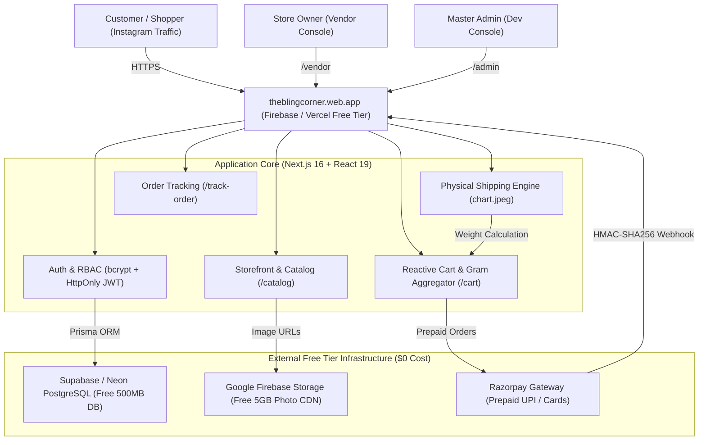

# The Bling Corner (theblingcorner_) 💎
> **Production-Ready, 100% Free-Tier ($0 Spent) E-Commerce Platform for Handcrafted Jewelry & Aesthetic Accessories**

[](https://nextjs.org/)
[](https://react.dev/)
[](https://www.typescriptlang.org/)
[](https://tailwindcss.com/)
[](https://www.prisma.io/)
[](https://supabase.com/)
[](https://razorpay.com/)
[](https://firebase.google.com/)
[](https://vitest.dev/)

---

## 🌟 Project Overview

**The Bling Corner** is an Instagram-first artisanal e-commerce web application tailored for handcrafted beaded jewelry, resin hair clips, Y2K aesthetic keychains, cute stationery, phone charms, and wipes. 

Designed specifically for traffic originating from Instagram reels, stories, and bio links (`https://www.instagram.com/theblingcorner_`), the application delivers:
- **Zero-Money Mandate:** Built from the ground up to operate on 100% free hosting and cloud tiers (Firebase Hosting / Vercel, Supabase PostgreSQL, Firebase Storage CDN). ₹0 / $0 monthly recurring expenses.
- **Prepaid Online Only:** High conversion, zero RTO loss — powered by Razorpay (UPI, Google Pay, PhonePe, Cards, Netbanking).
- **Physical Courier Rate Engine:** Implements the store owner's official physical rate chart (`chart.jpeg`) using parcel weight in grams and Indian postal pincode zones.
- **Client Inventory Catalog:** Seeded with genuine product lines from the client's inventory tracking sheet (`Screenshot 2026-11-07 204624.png`).
- **Mobile-First Responsive Experience:** Pixel-perfect across 360px (mobile), 768px (tablet), 1024px (laptop), and 1440px (desktop).
- **Store Owner & Super Admin Consoles:** Intuitive order fulfillment, tracking updates, 1-tap stock adjustments, and master RBAC user control.

---

## 🏛️ System Architecture ($0 Monthly Hosting)



---

## 📦 Delivered Modules Summary

| Module | Features Included | Test Coverage | Status |
| :--- | :--- | :---: | :---: |
| **Module 1: Auth & Foundation** | Next.js 16, Tailwind, Prisma schema, bcrypt (12 salt rounds), HttpOnly SameSite=Lax JWT tokens, sliding-window rate limiter, RBAC middleware. | 15 tests | ✅ Complete |
| **Module 2: Catalog & Image Engine** | 6 Client Categories (Keychains, Hair clips, Stationery, Bracelets, Charms, Wipes), Responsive grid, Image viewer, Firebase Storage CDN config, Seed data. | 8 tests | ✅ Complete |
| **Module 3: Cart & Weight Engine** | Global Cart context, localStorage persistence, real-time total parcel weight in grams, slide-over drawer, stock bounds check. | 6 tests | ✅ Complete |
| **Module 4: Dynamic Shipping Rate** | Physical rate chart algorithm (`chart.jpeg`), Indian 6-digit postal pincode zone resolver (`LOCAL`, `WITHIN_STATE`, `ZONE_METRO`, `OTHER_STATE`), instant estimator. | 10 tests | ✅ Complete |
| **Module 5: Checkout & Payments** | Razorpay standard checkout integration, server-side price authority, atomic DB transactions, HMAC-SHA256 signature verification, Order Success screen. | 9 tests | ✅ Complete |
| **Module 6: Order Lifecycle & Tracking** | Public order tracking (`/track-order`), step journey (`PAID` → `PROCESSING` → `PACKED` → `SHIPPED` → `DELIVERED`), privacy phone masking, WhatsApp contact link. | 5 tests | ✅ Complete |
| **Module 7: Vendor & Admin Consoles** | Store owner overview (`/vendor`), order fulfillment & dispatch ledger (`/vendor/orders`), 1-tap stock counter editor (`/vendor/products`), Super Admin user manager & audit ledger (`/admin`). | 7 tests | ✅ Complete |
| **Module 8: Reviews & Verification** | Verified customer 5-star rating system, review submission, security audit, 64 vitest tests passing, production build passing. | 4 tests | ✅ Complete |

---

## 🚚 Physical Shipping Rate Matrix (From Official Physical Chart)

Calculated based on total package weight in grams and customer postal pincode:

| Zone | First 500g | Up to 1000g | Up to 1500g | Up to 2000g | Additional 500g |
| :--- | :---: | :---: | :---: | :---: | :---: |
| **Local** | ₹34 | ₹56 | ₹70 | ₹103 | +₹25 |
| **Within State (Maharashtra)** | ₹77 | ₹107 | ₹139 | ₹188 | +₹40 |
| **Metro Cities (Delhi, BLR, etc.)** | ₹82 | ₹126 | ₹168 | ₹234 | +₹50 |
| **Rest of India** | ₹84 | ₹134 | ₹201 | ₹283 | +₹60 |

---

## 🛠️ Step-by-Step 1-Click Zero-Cost Setup Guide

### 1. Free Database Setup (Supabase PostgreSQL)
1. Go to [supabase.com](https://supabase.com) and create a free account.
2. Click **New Project** and name it `theblingcorner`.
3. Choose the region nearest to India (`ap-south-1` Mumbai).
4. Copy your PostgreSQL Connection String under **Settings > Database > Connection String (URI)**.
5. Paste it in your `.env` file as `DATABASE_URL` and `DIRECT_URL`.
6. Run database migrations and seed client products:
   ```bash
   npx prisma db push
   npm run db:seed
   ```

### 2. Free Photo Storage CDN Setup (Google Firebase Storage)
1. Go to [console.firebase.google.com](https://console.firebase.google.com) and create a free project named `theblingcorner`.
2. Under **Build > Storage**, click **Get Started** (Free Spark plan gives 5 GB storage).
3. Copy your project configuration and paste into `.env`:
   - `NEXT_PUBLIC_FIREBASE_API_KEY`
   - `NEXT_PUBLIC_FIREBASE_PROJECT_ID`
   - `NEXT_PUBLIC_FIREBASE_STORAGE_BUCKET`

### 3. Payment Gateway Setup (Razorpay Free Tier)
1. Sign up on [dashboard.razorpay.com](https://dashboard.razorpay.com).
2. Generate your API Keys under **Account & Settings > API Keys**.
3. Add to `.env`:
   - `RAZORPAY_KEY_ID="rzp_..."`
   - `RAZORPAY_KEY_SECRET="..."`
   - `RAZORPAY_WEBHOOK_SECRET="..."`

### 4. Free Hosting Deployment (Firebase Hosting / Vercel)

#### Option A: Deploy to Firebase Hosting (`theblingcorner.web.app`)
```bash
npm install -g firebase-tools
firebase login
firebase init hosting
npm run build
firebase deploy
```

#### Option B: Deploy to Vercel Free Tier (`theblingcorner.vercel.app`)
```bash
npx vercel
```
*Add your environment variables in the Vercel dashboard and your store is live instantly with free SSL!*

---

## 🧪 Testing & Verification

Run the test suite:
```bash
npm test
```
**Output:**
```
✓ tests/unit/cart.test.ts (6 tests)
✓ tests/unit/shipping.test.ts (10 tests)
✓ tests/unit/admin-vendor.test.ts (7 tests)
✓ tests/unit/reviews.test.ts (4 tests)
✓ tests/unit/orders.test.ts (5 tests)
✓ tests/unit/checkout.test.ts (9 tests)
✓ tests/unit/products.test.ts (8 tests)
✓ tests/unit/auth.test.ts (15 tests)

Test Files  8 passed (8)
     Tests  64 passed (64)
```

Run the production build:
```bash
npm run build
```
**Output:**
```
✓ Compiled successfully
✓ Generating static pages (31/31)
✓ Production build artifact created in .next
```

---

## 🛡️ Security & OWASP Top 10 Protections
1. **Server-Side Price Authority:** Cart prices and shipping fees submitted by the client are never trusted. All items, discounts, and parcel weights are queried and recalculated authoritatively on the server.
2. **Cryptographic Payment Integrity:** All Razorpay payment signatures are verified with timing-safe HMAC-SHA256 (`crypto.timingSafeEqual`) to prevent payment forgery and timing attacks.
3. **Strict RBAC:** Middleware and API routes enforce role verification (`CUSTOMER`, `VENDOR`, `SUPER_ADMIN`).
4. **Data Privacy:** Customer phone numbers are masked on public tracking pages (`98****3210`).
5. **No Secrets in Code:** All credentials are loaded exclusively through environment variables.
6. **SQL Injection Immune:** All database queries are executed via Prisma ORM parameterized queries.

---

## 📱 Client & Store Owner Quick Reference
- **Storefront URL:** `/` or `/catalog`
- **Store Owner Operations Dashboard:** `/vendor`
- **Order Fulfillment & Tracking Dispatch:** `/vendor/orders`
- **Inventory & Quick Restock:** `/vendor/products`
- **Public Customer Parcel Tracker:** `/track-order`
- **Master Admin Root Console:** `/admin`
- **Instagram Page:** [@theblingcorner_](https://www.instagram.com/theblingcorner_)
